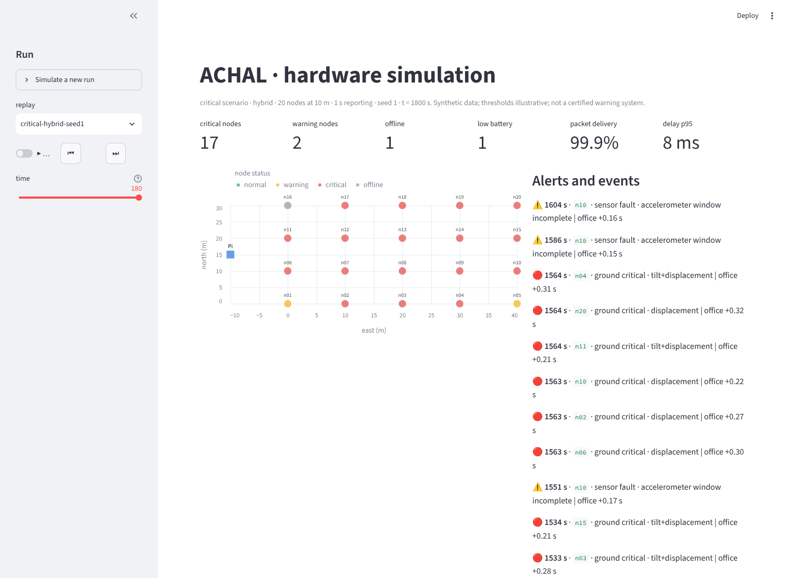
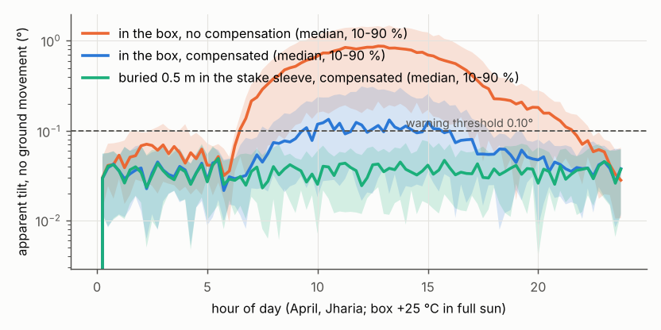
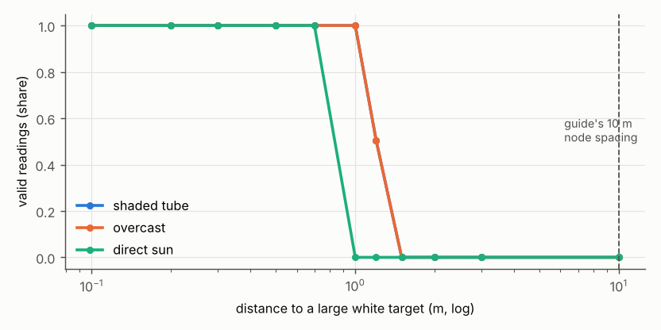
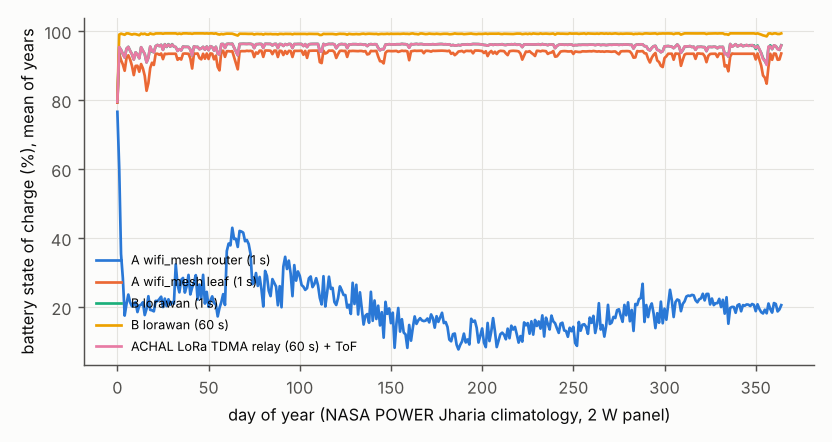
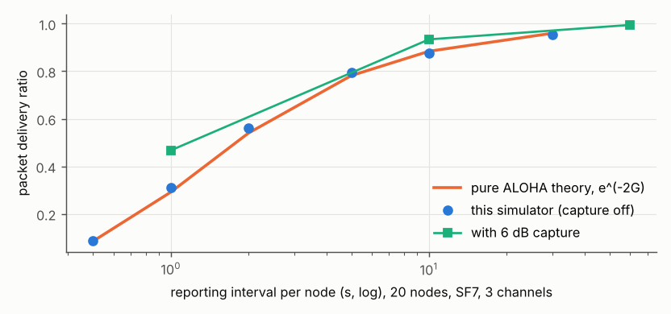
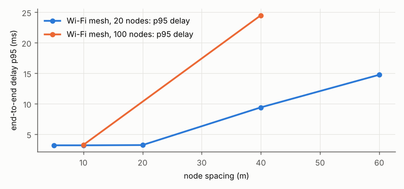

# ACHAL hardware simulation report

Team ACHAL · 27 Oct 2026 · code in [`services/hw-sim`](../../services/hw-sim), [`firmware/wokwi`](../../firmware/wokwi), raw results in [`reports/hwsim`](../../reports/hwsim)

> Research prototype simulation with synthetic data. ACHAL is not a certified mine-safety or alarm
> system. Thresholds are illustrative until calibrated on site against survey data.

## 1. Summary

We simulated the ACHAL surface node (ESP32, MPU6050, VL53L0X, 18650 cell with TP4056 and a solar
panel) and its network to a Raspberry Pi gateway, following every stage of the team's simulation
guide, and checked the models against datasheets, closed-form theory (pure ALOHA) and an independent
simulator (ns-3.44). The node's detection code is the firmware's own C library, run unchanged in
the simulator, in Wokwi and on the ESP32.

What the simulation shows:

1. **Detection works under realistic faults.** In the guide's first experiment (20 nodes, 10 m, 1 s,
   with lost packets, an offline node, a gateway outage and a low battery; 5 seeds × 3 scenarios ×
   3 networks), every node that truly reached warning or critical raised that alert (recall 100%).
   Critical alerts come a median 28–31 s after the ground crosses the critical level. That delay is
   the 3-window persistence filter plus a ToF reading every 30 s, chosen to keep false alarms down.
2. **The "< 2 s alert" figure applies to the network, not to detection.** Transport is 5 ms (p95)
   on Wi-Fi and 112 ms on LoRaWAN; detection with persistence adds seconds to tens of seconds.
3. **False alarms are low but not zero.** 2 of 100 node-runs in the normal scenario raised a false
   ground warning. Both were single-node tilt warnings late in the day that the gateway marked as
   not corroborated by neighbours: one on a healthy node (thermal drift), one on a node with the
   injected missing-samples fault. Burying the tilt sensor's pipe and temperature compensation are
   needed, not optional (E1), and multi-node corroboration should gate sirens.
4. **The VL53L0X is a short-range gauge.** It reaches 1.2 m on white in default mode, 0.55 m in
   direct sun, and nothing at 10 m. It cannot measure node-to-node distance on a 10–20 m grid. We use
   it to measure settlement against a target plate 0.5 m away (E2).
5. **A Wi-Fi mesh cannot run on an 18650 and a 2 W panel.** A Wi-Fi router node draws ~102 mA and
   is down ~2,200 h a year. LoRa nodes run all year with no outage (E3). This confirms the repo's
   LoRa design for the node and puts Wi-Fi only where mains or a large panel is available.
6. **LoRaWAN at 1 s reporting loses half its packets** to collisions (pure ALOHA, verified against
   theory). At 10 s it delivers 93%, at 60 s 99.5%. The 1 s rate is only viable on Wi-Fi (E4).

## 2. What was built (simulation guide, stage by stage)

| Guide stage | Built | Where |
| --- | --- | --- |
| 1. Labelled data: normal, warning, critical with noise, drift, missing samples, invalid readings | Gaussian subsidence bowl + blast bursts + faults; each sample labelled with ground truth | `scenarios.py` |
| 2. One node in Wokwi; feed simulated ToF if unsupported | ESP32 + MPU6050 in Wokwi, ToF from a slide pot with noise, fault button, LED + buzzer alarm, FAST/ECO sleep; automated `wokwi-cli` scenario | `firmware/src/wokwi-node`, `firmware/wokwi` |
| 2a. Same maths everywhere | One C library for tilt, PPV, dominant frequency, ToF filtering and the detector; host-tested, loaded by Python via ctypes | `firmware/lib/achal_dsp` |
| 3. 10–100 virtual nodes, direct vs multihop, options A/B/C | Component models + virtual nodes + Wi-Fi mesh, LoRaWAN and hybrid networks + Pi gateway | `services/hw-sim` |
| 3a. Validate the network model | Pure ALOHA closed form; ns-3.44 802.11 cross-check | E4, E5 |
| 4. Dashboard with scenario replay | Streamlit: node map, events, trends with ground truth, health table; live mode over MQTT | `services/hw-sim/dashboard` |
| Report PDR, delay, availability, outages | All runs report PDR, delay p50/p95/p99, per-node availability, outage hours | `reports/hwsim/*.json` |
| First experiment: 20 nodes, 10 m, 1 s, with failures | E6, 5 seeds × 3 scenarios × 3 networks | `reports/hwsim/e6_first_experiment.json` |



## 3. Method

**Ground truth.** Each scenario places 20–100 nodes on a grid and moves the ground with a Gaussian
subsidence bowl (tilt and settlement fall off with distance from an epicentre), optional blast
bursts (PPV with a DGMS frequency band), and a diurnal ground-temperature cycle. Labels use the
detector's thresholds on the true values: warning at tilt 0.10° or settlement 5 mm, critical at
0.30° or 15 mm. Vibration uses the DGMS Circular 7/1997 PPV limits (5 / 10 / 15 mm/s below 8 Hz,
8–25 Hz, above 25 Hz) and is capped at warning on its own.

**Sensors.** The MPU6050 model uses the datasheet noise density (400 µg/√Hz), zero-g offsets and a
temperature coefficient drawn per unit (σ 0.35 mg/°C, an assumption inside the datasheet's ±35 mg
over temperature), plus slow bias wander. The VL53L0X model is a photon budget calibrated to the
datasheet's range table (1.2 m white indoor default, 2 m long-range), with sigma and signal-rate
limit checks, ambient light, the 25° cone and the fraction of the cone the target plate fills.

**Power.** Hourly energy balance over a year: an 18650 with an NMC open-circuit curve and DW01
cut-off, a 2 W panel (with 15% coal-dust soiling) feeding a TP4056, and hourly irradiance built from
NASA POWER monthly climatology for Jharia (23.75° N, 86.42° E) with day-to-day persistence. Box
temperature rises with sun. Node load comes from per-state ESP32, radio and sensor currents.

**Network.** Option A is a tree mesh like ESP-WIFI-MESH: two-ray path loss with clutter, a
packet-error curve around the receiver's sensitivity, 802.11 retries and per-hop forwarding delay,
re-parenting after a node failure, and a root queue at the Pi. Option B is LoRaWAN class A: SF by
ADR margin, pure ALOHA on 3 channels with 6 dB capture. Option C is A on site plus a LoRa backhaul
(Okumura–Hata with 20 dB terrain loss) that carries summaries and events.

**Node.** `node.py` runs the firmware loop each second: 1 s accelerometer window at 200 Hz, tilt
from the mean gravity vector (EMA, τ 10 s), PPV and dominant frequency from the window,
temperature compensation, a 7-shot ToF burst every 30 s through the median filter, baseline after
install, the shared detector (3-window persistence, 10-window clear, 0.8 hysteresis), timestamps
from a drifting RTC resynced every 60 s, and a packet. Windows with under 50% of samples are
dropped and flagged rather than used.

**Statistics.** Each figure is the mean over seeds with a 95% interval (1.96 σ/√n) unless stated.

## 4. Results

### E1 · MPU6050 tilt and vibration

| Quantity | Result |
| --- | --- |
| Tilt noise, 200-sample window | 0.020° (σ), so 0.10° warning is 5σ above noise |
| Worst tilt error over an April day, no compensation | median 0.88°, 95% of units exceed 0.10° |
| Same, with temperature compensation | median 0.15°, 65% exceed 0.10° |
| Same, compensated and buried (0.6 m, damped temperature swing) | median 0.088°, 20% exceed 0.10° |
| PPV noise floor (quiet ground) | median 1.95 mm/s, p99 3.6 mm/s, against a 5 mm/s limit |
| PPV estimator, 4–15 Hz | within 8% of the true PPV |
| PPV estimator, 25–40 Hz | 12–15% low (the 200 Hz sampling and the filter) |

Thermal drift, not noise, is what limits tilt. A surface-mounted MPU6050 cannot hold a 0.10°
threshold over a day. Burying the pipe and compensating with the on-chip temperature sensor brings
most units under it; 20% still drift past, which is why the detector needs persistence and why the
gateway's multi-node consensus matters.



### E2 · VL53L0X range and gauge design

| Mode | Shaded tube, white | Overcast, white | Direct sun, white | Shaded tube, grey |
| --- | --- | --- | --- | --- |
| Default (33 ms) | 1.20 m | 0.82 m | 0.55 m | 0.53 m |
| High accuracy (200 ms) | 1.20 m | 1.20 m | 0.87 m | 0.53 m |
| Long range | 1.90 m | 1.57 m | 1.01 m | 0.83 m |

At 10 m no reading is valid in any condition. Plate size at 0.5 m changes the result: an 80 mm
plate reads +114 mm too long (the cone sees the ground behind it), 150 mm reads +24 mm, 250 mm reads
true (σ 1.0 mm). The design that follows: high-accuracy mode, a 250 mm white plate on a stake 0.5 m
away, a sight tube for shade, a 7-shot median, and a fresh reference calibration when the
temperature moves by 4 °C.



### E3 · Energy over a year (2 W panel, 10 weather-years)

| Node profile | Average draw | Days on battery alone | Downtime per year | Charging outside 0–50 °C |
| --- | --- | --- | --- | --- |
| A · Wi-Fi mesh router, 1 s | 101.8 mA | 1.0 | 2,208 h (188 h on 5 W) | 441 h |
| A · Wi-Fi mesh leaf, 1 s | 21.8 mA | 4.6 | 1.3 h | 221 h |
| B · LoRaWAN, 1 s | 13.8 mA | 7.3 | 0 | 148 h |
| B · LoRaWAN, 10 s | 3.5 mA | 28.5 | 0 | 93 h |
| B · LoRaWAN, 60 s | 2.1 mA | 47.6 | 0 | 71 h |
| ACHAL LoRa TDMA leaf, 60 s + ToF | 4.96 mA | 20.2 | 0 | 123 h |
| ACHAL LoRa TDMA relay, 60 s + ToF | 13.8 mA | 7.3 | 0 | 148 h |
| Same relay, TP4056 NTC wired | 13.8 mA | 7.3 | 0 | 0 h |

Three hardware findings follow. The common TP4056 module grounds its TEMP pin, so in a sun-heated
box it charges the cell above 45 °C for 70–440 h a year; wiring a 10 k NTC fixes that. The HT7333
regulator (250 mA) cannot supply Wi-Fi transmit peaks (~280 mA). The Raspberry Pi gateway needs
about 142 Wh a day, so a solar gateway needs a ~67 W panel and ~71 Ah at 12 V for three cloudy days.



### E4 · Network: direct vs multihop, A vs B vs C

| Network | Nodes, spacing, interval | Delivery | Delay p50 / p95 | Hops (mean / max) |
| --- | --- | --- | --- | --- |
| A Wi-Fi mesh | 20, 10 m, 1 s | 100% | 2.3 / 3.2 ms | 1.0 / 1 |
| A Wi-Fi mesh | 20, 60 m, 1 s | 100% | 3.8 / 14.8 ms | 1.7 / 3 |
| A Wi-Fi mesh | 100, 10 m, 1 s | 100% | 2.3 / 3.3 ms | 1.03 / 2 |
| A Wi-Fi mesh | 100, 40 m, 1 s | 100% | 10.4 / 24.5 ms | 2.7 / 6 |
| B LoRaWAN | 10, 10 m, 1 s | 69.7% | 105 / 112 ms | 1 |
| B LoRaWAN | 20, 10 m, 1 s | 46.7% | 105 / 112 ms | 1 |
| B LoRaWAN | 100, 10 m, 1 s | 8.5% | 105 / 112 ms | 1 |
| B LoRaWAN | 20, 10 m, 10 s | 93.4% | 105 / 112 ms | 1 |
| B LoRaWAN | 20, 10 m, 60 s | 99.5% | 105 / 112 ms | 1 |

Multihop appears only when the grid is sparse (40–60 m) or large; at the guide's 10 m spacing every
node hears the Pi directly. LoRaWAN delivery follows pure ALOHA: with capture turned off, the
simulator matches S = e^(−2G) within its 95% interval at every load (0.31 vs 0.29 at 1 s, 0.88 vs
0.88 at 10 s). For option C, sending raw 1 s readings over the backhaul would need 164% of the
channel at SF7; sending summaries and events needs 2.2%, with an event reaching the office in a
median 0.22 s over 2–10 km.




### E5 · Cross-check against ns-3.44

ns-3 has no ESP-WIFI-MESH model, so we checked the link and MAC abstraction with single-hop 802.11
(DCF, OFDM 6 Mb/s timing, 2.437 GHz, two-ray ground) in ns-3 against the Python model on the same
geometry (20 nodes, 3 seeds).

| Spacing, interval | Python delivery | ns-3 delivery | Python MAC delay p50 | ns-3 delay p50 |
| --- | --- | --- | --- | --- |
| 10 m, 1 s | 1.00 | 1.00 | 0.30 ms | 0.33 ms |
| 80 m, 1 s | 1.00 | 1.00 | 0.30 ms | 0.33 ms |
| 120 m, 1 s | 0.82 | 0.60 | 0.30 ms | 0.33 ms |
| 160 m, 1 s | 0.61 | 0.50 | 0.30 ms | 0.35 ms |
| 200 m, 1 s | 0.51 | 0.30 | 0.30 ms | 0.31 ms |
| 10 m, 50 ms | 1.00 | 0.995 | 0.30 ms | 0.26 ms |
| 10 m, 10 ms | 1.00 | 0.985 | 0.30 ms | 0.45 ms |

The two agree on per-hop delay and on where single-hop links start to fail (100–120 m). At the
edge, Python is 0.1–0.2 more optimistic: its packet-error curve is softer than ns-3's error-rate
model. At 100 packets a second per node Python misses 1.5% of contention losses. Neither matters at
the guide's 10–20 m spacing and 1 s rate, where the mesh builds multihop paths long before 100 m.

### E6 · First experiment (guide): 20 nodes, 10 m, 1 s, with failures

Injected in every run: a 60 s, 25 dB fade (lost packets), one node offline for 60 s, a 90 s gateway
outage, one node with a leaking battery, plus the scenario's sensor faults (accelerometer drift,
missing samples, invalid and rain-hit ToF readings, a dead node). 5 seeds.

| Scenario · network | Delivery | Delay p95 | Warning recall | Critical recall, median latency | False-alarm nodes |
| --- | --- | --- | --- | --- | --- |
| Normal · Wi-Fi / hybrid | 99.96% | 4.9 ms | — | — | 2 of 100 |
| Normal · LoRaWAN | 45.0% | 112 ms | — | — | 2 of 100 |
| Warning · Wi-Fi / hybrid | 99.96% | 4.9 ms | 58/58 | — | 3 of 26 |
| Warning · LoRaWAN | 45.0% | 112 ms | 58/58 | — | 3 of 26 |
| Critical · Wi-Fi / hybrid | 99.96% | 4.9 ms | 87/87 | 74/74, 28 s | 1 of 8 |
| Critical · LoRaWAN | 45.0% | 112 ms | 87/87 | 74/74, 31 s | 1 of 8 |

False-alarm nodes are nodes whose ground stayed below half the warning level all run but raised a
ground alert. Warning alerts fire a median 46–101 s before the true value crosses 0.10°: noise and
drift near the threshold push nodes over early. They are counted as detections because those nodes
do cross, but they are partly luck, not skill. Packet timestamps are within 34 ms (p95) of true
time with a 60 s resync. On vibration, 61 nodes truly exceeded the DGMS limit and 75 raised an
advisory: 14 advisories came from MPU6050 noise near the 5 mm/s limit (E1's floor reaches 3.6 mm/s
at p99), so vibration is advisory only. LoRaWAN loses half the packets at 1 s but still detects
everything, because the node decides locally and an alert needs only one packet to arrive; it pays
in latency (+2–3 s for critical).

## 5. Limits

- The ground model is a smooth bowl. Real subsidence over old bord-and-pillar workings is patchy and
  can be sudden (pillar collapse). Real precursor rates must come from site data.
- The VL53L0X model is calibrated to datasheet figures, not to our own bench measurements; dust,
  condensation on the window and spider webs are modelled only as random spurious returns.
- The MPU6050 temperature coefficient per unit is an assumption inside the datasheet's bound. A
  temperature-chamber test of 10 real units would replace it.
- ESP-WIFI-MESH is modelled as a generic tree; its own root election, routing table limits and
  re-association times are not.
- Wokwi runs the firmware and the MPU6050's registers, not the VL53L0X, the radio, or power.
- The energy study uses climatology with synthetic day-to-day weather, not a recorded year.
- Every parameter not from a datasheet or a published measurement is marked `ASSUMPTION` in the
  source and can be swept.

## 6. What changed in the design (merged into the repo)

| Change | Why |
| --- | --- |
| VL53L0X added to the node (I2C 0x29, XSHUT GPIO 32, switched rail), new `tof_mm` field in the radio frame (reserved bytes, no format break) | Hardware table and technical report specify it |
| ToF used as a 0.5 m settlement gauge with a 250 mm plate, not a node-to-node gauge | E2: range 1.2 m at best |
| TP4056 NTC must be wired | E3: 70–440 h a year of hot charging otherwise |
| Tilt pipe buried 0.6 m, temperature compensation on | E1 |
| Node keeps LoRa (SX1276); Wi-Fi only for mains-powered or large-panel nodes; LoRaWAN would need an SX1302 concentrator HAT on the Pi | E3, E4 |
| Node cost ₹3,773 → ₹4,240 (VL53L0X ₹245 + plate and sight tube ₹150, with GST); 25-node kit ₹1,24,923, ₹139 per person | `hardware/cost-summary.md` |
| Leaf average draw 4.96 mA at 60 s (20 days on battery), relay 13.8 mA (7 days) | `hardware/power-budget.md` |

## 7. Reproduce

```bash
pip install -r services/hw-sim/requirements.txt
export PYTHONPATH=services/hw-sim/src
python -m achal_hwsim.experiments            # E1–E6, ~20 min; E5 needs ACHAL_NS3_BIN
pytest -q services/hw-sim                     # model and parity tests
cd firmware && pio test -e native             # achal_dsp tests on the host
```

Data: NASA POWER (power.larc.nasa.gov), monthly climatology for 23.75° N, 86.42° E, fetched
27 Oct 2026, in `data/hwsim/nasa_power_jharia.json`.
